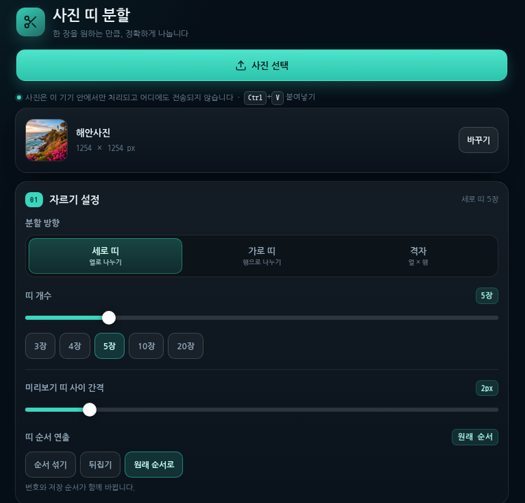
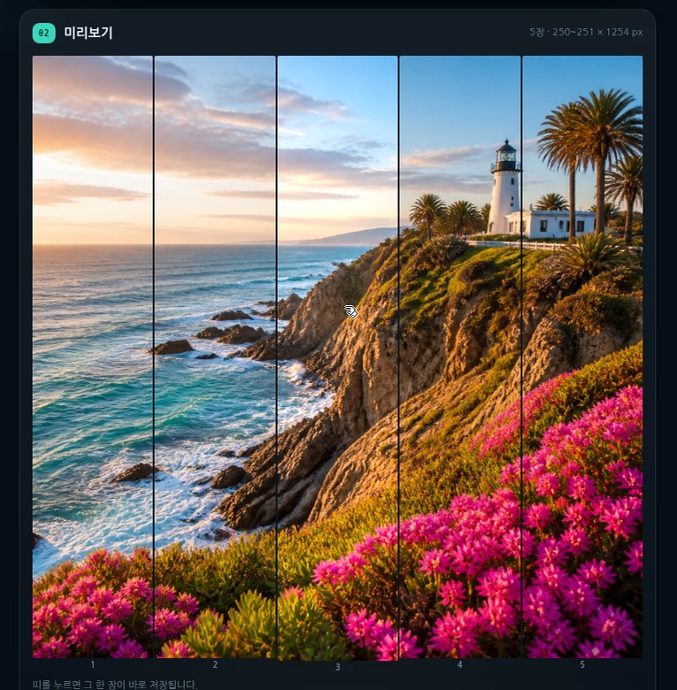

<div align="center">

# ✂️ 사진 띠 분할

**사진 한 장을 세로 띠 · 가로 띠 · 격자로 정확하게 나눠 주는 웹앱**

설치도, 회원가입도, 서버 업로드도 없습니다. 사진은 이 기기 안에서만 처리됩니다.

[](https://moocho-kosoo.github.io/Kosoo/)




</div>

---

## 🖼️ 이런 앱입니다

인스타그램 캐러셀처럼 한 장의 사진을 여러 장으로 쪼개고 싶을 때, 포토부스 띠처럼 세로로 길게 자르고 싶을 때 쓰는 도구입니다.
사진을 고르고 방향과 장수를 정하면, 나뉜 조각을 **ZIP 한 파일**, **낱장 전부**, **합본 한 장** 중 원하는 모습으로 저장하거나 바로 공유할 수 있습니다.

미리보기에서는 잘린 조각들이 흩어지지 않고 **원본 사진의 구도 그대로** 놓여서, 어디가 어떻게 나뉘는지 한눈에 확인할 수 있습니다.



## ✨ 주요 기능

| | 기능 | 내용 |
|---|---|---|
| 📐 | **분할 방향** | 세로 띠(열로 나누기) · 가로 띠(행으로 나누기) · 격자(열 × 행) |
| 🔢 | **장수** | 세로·가로 띠 2~20장 (3·4·5·10·20장 프리셋), 격자는 최대 20열 × 10행 = 200장 |
| 🔀 | **순서** | 순서 섞기 · 뒤집기 · 원래 순서로 — 번호와 저장 순서가 함께 바뀝니다 |
| 🎨 | **파일 형식** | PNG(무손실) · JPG(용량 작게) · WebP(고효율), 파일 이름 앞부분 지정 |
| 💾 | **저장** | ZIP 한 파일 · 나눠서 모두 · 합본 한 장(간격·배경색) · 기기 공유 시트 |
| 📤 | **공유** | 합본 1장을 미리 보고 바로 공유 (X·인스타그램·스레드·카카오톡 등 공유 시트에 뜨는 모든 앱) |
| 📱 | **SNS 용량 맞춤** | 합본이 5MB를 넘으면 JPG로 자동 변환·축소해 한 장으로 올라가게 합니다 |
| 👆 | **낱장 저장** | 미리보기에서 띠를 누르면 그 한 장이 바로 저장됩니다 |
| 📋 | **불러오기** | 사진 선택 · 드래그 앤 드롭 · 클립보드 붙여넣기(Ctrl+V), JPG · PNG · WebP · GIF |
| 🔒 | **동작 방식** | 서버 · 외부 라이브러리 · 인터넷 연결 없이 브라우저 안에서만 (ZIP 생성기까지 직접 구현) |

## 🚀 3단계면 끝납니다

1. **사진 불러오기** — `사진 선택`을 누르거나, 사진을 끌어다 놓거나, Ctrl+V로 붙여넣습니다.
2. **자르기 설정** — 세로 띠 / 가로 띠 / 격자를 고르고 장수를 정합니다. 미리보기에서 결과를 확인합니다.
3. **저장하거나 공유하기** — ZIP · 나눠서 · 합본 · 공유 중 하나를 고르면 끝입니다.

## 💾 저장 방식 한눈에

| 방식 | 결과물 | 언제 쓰나요 |
|---|---|---|
| **ZIP 저장하기** | 나뉜 조각 전부를 ZIP 한 파일로 | 한꺼번에 받아 두고 나중에 올릴 때 |
| **나눠서 저장하기** | 조각마다 파일 하나씩 | 골라서 쓰거나 순서대로 올릴 때 |
| **합본 한 장에 저장하기** | 조각을 다시 이어 붙인 이미지 1장 (간격·배경색 적용) | 한 장으로 올리고 싶을 때 |
| **공유하기** | 합본 1장을 공유 시트로 바로 전달 | X·인스타그램·카카오톡에 바로 올릴 때 |

- 합본 배경색은 투명 · 흰색 · 검정 · 노랑 · 주황빨강에서 고르거나 직접 지정할 수 있습니다.
- JPG는 투명을 지원하지 않아 투명 배경을 고르면 흰색으로 채워집니다. 배경색은 합본 한 장에만 적용됩니다.
- 공유 창에서는 낱장 공유(최대 20장) · 합본 저장 · ZIP 저장도 함께 할 수 있습니다.

## 🌐 지원 브라우저

Android Chrome, iOS Safari, 데스크톱 Chrome · Edge · Safari 최신 버전에서 동작합니다.

- 여러 파일을 한꺼번에 저장할 때 브라우저가 **"여러 파일 다운로드 허용"**을 물으면 허용해 주세요.
- WebP 저장을 지원하지 않는 브라우저에서는 자동으로 PNG로 저장됩니다.

## 🔐 사진은 어디로도 가지 않습니다

모든 자르기·합치기·압축은 브라우저 안에서만 이루어집니다. 사진이 서버로 전송되는 단계가 없고, 계정 로그인이나 클라우드 저장 기능도 없습니다.
그래서 인터넷이 끊겨 있어도, 파일 하나만 내려받아 열어도 그대로 쓸 수 있습니다.

## 📁 파일 구성

```
Kosoo/
├─ index.html   ← 앱 전체. 이 파일 하나로 동작합니다
├─ docs/        ← README에 쓰인 화면 이미지
└─ README.md
```

`index.html`은 빌드 과정이 없는 단일 파일입니다. 내려받아 브라우저로 열면 오프라인에서도 실행됩니다.
다만 로컬 파일로 열면 브라우저 보안 정책상 `공유하기`가 막히므로, 공유까지 하려면 [웹 주소](https://moocho-kosoo.github.io/Kosoo/)로 열어 주세요.

<div align="center">
<sub>만든 사람 · <a href="https://x.com/Whiskey_Achon">@Whiskey_Achon</a></sub>
</div>
